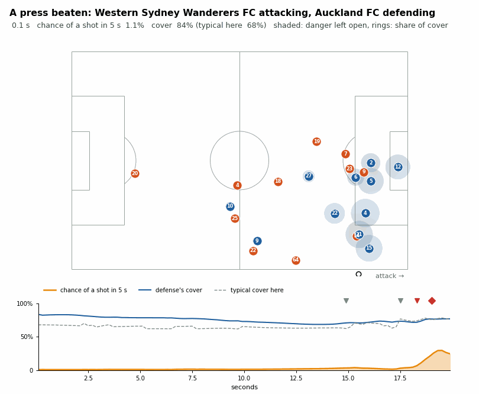

# Defensive Cover

**How much danger does a defense leave open, and does it change what happens next?**
A tracking-based measure of defending for the SkillCorner X PySport Analytics Cup (research
track), built on the SkillCorner open data (A-League 2024/25, 20 matches) and shipped as the
`dsv` Python package.

Video (1 minute): *link to be added*

## Introduction

Most defending never appears in event data: the best defensive work is the pass that is
never played. Tracking data can see it, and many space metrics already exist (pitch
control, threat-weighted pitch control, accessible space), but they are rarely tested
against what happens on the pitch. This project asks a narrow, testable question: at a
given moment, does the share of the dangerous space the defense covers predict whether the
attack gets a shot, beyond where the ball is? And if it does, what does it say about
pressing, the defensive action that trades space for a chance to win the ball?

## Methods

1. **Pitch control fitted to the open data.** Spearman's arrival-time model with parameters
   fitted to 15,078 open-data passes (held out by match), each player's measured top
   speed, and extra uncertainty for positions SkillCorner extrapolates off camera. Held-out
   log loss 0.224 against 0.262 for the literature defaults.
2. **Danger.** An xG model fitted on the competition's 524 shots from the tracking at the
   shot frame, expected threat (xT) fitted on the 20 matches, and a fitted model of where
   the ball goes next. *Reachable danger* is the danger of the places the ball can reach
   next; the defense's *cover* is the share of it they would reach first.
3. **A pre-declared test, and why it failed.** Our first metric multiplied the two (Threat
   Conceded = reachable danger × uncovered share). Declared in advance: it must beat ball
   distance to goal at predicting shots. It did not (held-out log loss 0.289 vs 0.283).
   Fitted freely, the ball's situation weighs about 2.3 times as much as the defense's
   share (2.43 vs 1.04 on the log scale), so the product hides the defense.
4. **The two-part model.** A logistic model of a shot in the next 5 s from a flexible
   description of the ball's situation plus the defense's cover, computed five times a
   second for every possession, with a typical-cover model as the reference.
5. **Pressing.** Each of SkillCorner's 14,872 on-ball engagements is measured 3 s after the
   decision to press against typical play from the same situation: the effect on the ball
   and on the defensive shape, in shots prevented.

Everything is evaluated on matches the model did not see (leave one match out) with
match-bootstrap intervals.

## Results

| does the defense's cover predict what happens next? | held-out log loss difference [95%] |
|---|---|
| shot within 5 s, moment by moment (308,004 frames) | −0.0026 [−0.0035, −0.0017] |
| ball into the box within 5 s | −0.0037 [−0.0051, −0.0023] |
| shot in the possession, cover at the moment of peak danger | −0.0054 [−0.0096, −0.0013] |
| shot in the possession, cover averaged over the possession | −0.0003 [−0.0021, +0.0016] |

- **At a given ball situation, more cover means fewer shots.** Each unit of cover on the
  logit scale multiplies the odds of a shot in the next 5 s by 0.35.
- **Defending is decided at the critical moment.** Cover at peak danger predicts shots;
  cover averaged over a possession does not. It matters most when the defense is not set
  (set plays, direct play, the finishing phase).
- **Presses.** Measured against typical play, the grades agree with SkillCorner's own
  outcome flags: a beaten press costs 13.1 shots per 100 [9.4, 16.7], presses that reduce
  the danger save 5.1 and presses that force the ball back 1.6. Three in four presses
  leave the attack worse off than typical; the losses come from the own third.
- **What does not work yet.** Blaming the individual presser by lost cover does not single
  out beaten presses (AUC 0.54), and players' pressing values are not stable within a
  position over 20 matches (split-half 0.10). Role, not individual skill, is what the data
  can measure.



## Conclusion

The defense's cover of reachable danger predicts shots on held-out matches once it is kept
apart from where the ball is. Multiplying the two, as most space-value metrics do, hid it:
a lesson for anyone ranking or optimizing defenses with threat-weighted pitch control. The
package ships every model fitted to the open data so others can score their own
situations, and an interactive replay shows the measure moving through possessions. Next:
more matches per player, to see whether individual defending skill becomes measurable.

## Run it

Python 3.10 or newer. In a clean environment:

```
git clone <this repository> && cd <repository>
python -m pip install -e .
python -m pip install notebook
jupyter notebook submission.ipynb
```

[`submission.ipynb`](submission.ipynb) downloads one match (about 90 MB) straight from the
[SkillCorner open data](https://github.com/SkillCorner/opendata) and replays a possession
through the whole model in a few minutes, using the constants shipped in `dsv`. The
20-match analysis (about three hours) is `python scripts/00_fetch_data.py` followed by
scripts `01` to `14`, each writing a report to [`reports/`](reports). Commands, every model
and its validation, and notes on the open data: [docs/RESEARCH.md](docs/RESEARCH.md).

## Repository

`dsv/` the package (pitch control, xG, xT, threat, two-part model, attribution, pressing),
`scripts/` the pipeline, `explorer/` the interactive replay, `reports/` and `figs/` the
outputs, `tests/` the tests. MIT licence ([LICENSE.md](LICENSE.md)). Data: SkillCorner open
data, loaded from its GitHub repository and not included here.
