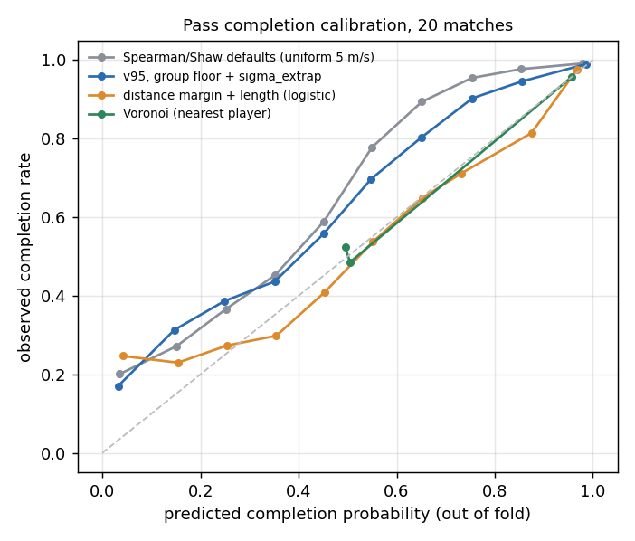
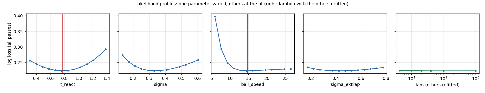

# Fitting pitch control to SkillCorner open data

Spearman-style pitch control (`dsv/pitchcontrol.py`) fitted to **15,078 passes** from all 20 SkillCorner open-data matches (A-League 2024/25, broadcast tracking, 10 fps). Pass completion rate 87.2%. The model's completion probability is the passing team's control at the ball's destination, evaluated at the frame the pass is played.

## Recommended settings

Selected by out-of-fold log loss: **v95, group floor + sigma_extrap**. Top speed: `vmax_table(v95, floor_quantile=0.25, gk_vmax=None)`.

| parameter | Spearman/Shaw default | fitted | fold-to-fold range |
|---|---|---|---|
| t_react (s) | 0.7 | **0.770** | 0.758 – 0.785 |
| sigma (s) | 0.45 | **0.335** | 0.326 – 0.342 |
| ball_speed (m/s) | 15 | **14.699** | 13.857 – 15.208 |
| sigma_extrap (s) | = sigma | **0.431** | 0.413 – 0.444 |
| lam (1/s) | 4.3 | **40** (fixed, see below) | – |

Goalkeeper control rate x3. In code: `dsv.pitchcontrol.SKILLCORNER_OPEN_DATA`; for tracking without detection flags, `SKILLCORNER_OPEN_DATA_NO_FLAGS` (the floor-only spec's own fit).

## Out-of-fold performance

Match-grouped 5-fold cross-validation: every number comes from matches the parameters (or baseline) never saw. Lower log loss, Brier and ECE are better; higher AUC is better.

| model | log loss | Brier | AUC | ECE |
|---|---|---|---|---|
| **v95, group floor + sigma_extrap** (selected) | 0.2239 | 0.0620 | 0.937 | 0.043 |
| v95, group floor | 0.2248 | 0.0622 | 0.937 | 0.043 |
| raw v95 + sigma_extrap | 0.2252 | 0.0625 | 0.937 | 0.043 |
| raw v95 | 0.2260 | 0.0626 | 0.936 | 0.044 |
| v95, group floor, GK 5 m/s | 0.2329 | 0.0634 | 0.936 | 0.047 |
| v95, GK 5 m/s | 0.2340 | 0.0637 | 0.936 | 0.047 |
| distance margin + length (logistic) | 0.2430 | 0.0727 | 0.907 | 0.017 |
| uniform 5 m/s | 0.2439 | 0.0658 | 0.935 | 0.054 |
| Spearman/Shaw defaults (uniform 5 m/s) | 0.2616 | 0.0724 | 0.932 | 0.080 |
| Voronoi (nearest player) | 0.2742 | 0.0802 | 0.800 | 0.004 |
| pass length (logistic) | 0.3606 | 0.1050 | 0.620 | 0.016 |

The seven fitted specs differ only in top speed and in `sigma_extrap`. Baselines are fitted on the same training folds: *Voronoi (nearest player)* uses the completion rate of passes whose destination is nearest a teammate vs an opponent; *distance margin + length (logistic)* is a logistic regression on (nearest-opponent distance − nearest-teammate distance), its sign, and pass length.

### Selected spec minus each alternative, 95% match-bootstrap intervals

Out-of-fold log loss difference (negative favours the selected spec), resampling the 20 matches 2,000 times.

| comparison | Δ log loss | 95% interval |
|---|---|---|
| vs Spearman/Shaw defaults (uniform 5 m/s) | -0.0377 | [-0.0446, -0.0305] |
| vs distance margin + length (logistic) | -0.0191 | [-0.0255, -0.0122] |
| vs Voronoi (nearest player) | -0.0503 | [-0.0602, -0.0412] |
| vs uniform 5 m/s | -0.0200 | [-0.0251, -0.0147] |
| vs raw v95 | -0.0021 | [-0.0036, -0.0005] |
| vs v95, group floor | -0.0009 | [-0.0020, +0.0003] |
| vs v95, GK 5 m/s | -0.0101 | [-0.0133, -0.0068] |
| vs v95, group floor, GK 5 m/s | -0.0090 | [-0.0121, -0.0058] |
| vs raw v95 + sigma_extrap | -0.0013 | [-0.0024, -0.0003] |

## Top speed: what helps

Final fits on all passes, one per spec:

| spec | top speed | t_react | sigma | sigma_extrap | ball speed |
|---|---|---|---|---|---|
| uniform 5 m/s | `5 m/s for everyone` | 0.835 | 0.398 | – | 13.38 |
| raw v95 | `vmax_table(v95, floor_quantile=None, gk_vmax=None)` | 0.777 | 0.353 | – | 14.29 |
| v95, group floor | `vmax_table(v95, floor_quantile=0.25, gk_vmax=None)` | 0.777 | 0.347 | – | 14.20 |
| v95, GK 5 m/s | `vmax_table(v95, floor_quantile=None, gk_vmax=5.0)` | 0.811 | 0.358 | – | 14.05 |
| v95, group floor, GK 5 m/s | `vmax_table(v95)` | 0.811 | 0.356 | – | 14.03 |
| raw v95 + sigma_extrap | `vmax_table(v95, floor_quantile=None, gk_vmax=None)` | 0.773 | 0.341 | 0.440 | 14.54 |
| v95, group floor + sigma_extrap | `vmax_table(v95, floor_quantile=0.25, gk_vmax=None)` | 0.770 | 0.335 | 0.431 | 14.70 |

## Control rate lambda is only bounded from below

Selected spec, lambda fixed and the other parameters refitted on all passes:

| lambda (1/s) | log loss | t_react | sigma | ball_speed | sigma_extrap |
|---|---|---|---|---|---|
| 4.3 | 0.2238 | 0.756 | 0.156 | 16.229 | 0.489 |
| 10 | 0.2238 | 0.764 | 0.285 | 15.102 | 0.479 |
| 20 | 0.2234 | 0.769 | 0.318 | 14.861 | 0.450 |
| 40 | 0.2232 | 0.770 | 0.335 | 14.699 | 0.431 |
| 100 | 0.2232 | 0.773 | 0.347 | 14.523 | 0.415 |
| 1000 | 0.2233 | 0.776 | 0.352 | 14.449 | 0.399 |

The fit keeps improving as lambda grows and flattens out: the data prefer the limit where the ball goes to whoever arrives first, with sigma carrying the timing uncertainty. Part of this is built into the test, since a pass's destination is where someone actually controlled the ball. Lambda is fixed at 40/s, the smallest round value within about 0.001 log loss of the plateau, which keeps the goalkeeper's faster control meaningful. It was chosen before cross-validation on all passes, a one-parameter choice that leaks slightly into the out-of-fold numbers.

## Robustness

**Extrapolated positions.** Passes split by whether the passer's nearest teammate and nearest opponent to the destination were detected (out-of-fold predictions):

| nearest players | model | passes | log loss | AUC | ECE |
|---|---|---|---|---|---|
| both detected | v95, group floor + sigma_extrap | 11,784 | 0.1919 | 0.942 | 0.045 |
| both detected | raw v95 | 11,784 | 0.1947 | 0.941 | 0.048 |
| both detected | raw v95 + sigma_extrap | 11,784 | 0.1932 | 0.942 | 0.046 |
| both detected | v95, group floor | 11,784 | 0.1935 | 0.941 | 0.047 |
| both detected | distance margin + length (logistic) | 11,784 | 0.2188 | 0.902 | 0.016 |
| one extrapolated | v95, group floor + sigma_extrap | 2,196 | 0.2688 | 0.934 | 0.042 |
| one extrapolated | raw v95 | 2,196 | 0.2599 | 0.935 | 0.037 |
| one extrapolated | raw v95 + sigma_extrap | 2,196 | 0.2701 | 0.933 | 0.043 |
| one extrapolated | v95, group floor | 2,196 | 0.2583 | 0.936 | 0.037 |
| one extrapolated | distance margin + length (logistic) | 2,196 | 0.2533 | 0.921 | 0.028 |
| both extrapolated | v95, group floor + sigma_extrap | 1,098 | 0.4781 | 0.864 | 0.053 |
| both extrapolated | raw v95 | 1,098 | 0.4940 | 0.862 | 0.054 |
| both extrapolated | raw v95 + sigma_extrap | 1,098 | 0.4795 | 0.863 | 0.052 |
| both extrapolated | v95, group floor | 1,098 | 0.4935 | 0.862 | 0.061 |
| both extrapolated | distance margin + length (logistic) | 1,098 | 0.4824 | 0.852 | 0.058 |

With `sigma_extrap`, extrapolated players get 29% more timing uncertainty than detected ones (0.431 s vs 0.335 s). It helps most when both nearest players are extrapolated (where it overtakes the logistic baseline) and slightly hurts when exactly one is. Overall its gain over the same spec without it is small; see the bootstrap table.

**Look-ahead.** Velocities are Savitzky-Golay smoothed over ±0.3 s, so the pass-frame state uses 0.3 s of future positions. Evaluating on the state 0.3 s *before* the pass removes that (final parameters, in-sample):

| state used | log loss | AUC | ECE |
|---|---|---|---|
| pass frame | 0.2232 | 0.938 | 0.043 |
| 0.3 s before the pass | 0.2371 | 0.931 | 0.043 |

## Caveats

- The destination of a failed pass is where an opponent took the ball, which makes the test easier than predicting the intended target. This is the standard set-up (Spearman 2017), and the baselines get the same advantage.
- Passes that went out of play, or whose next possession started more than 5 s later, are excluded.
- The selected spec is the best of 7 on the same folds, so its out-of-fold score is slightly optimistic. The bootstrap intervals show which differences are larger than that.
- One season of one league, broadcast tracking with about 57% of positions detected. Fitted parameters absorb some tracking error and may not transfer to optical tracking.
- The fitted surface is a control share, not a calibrated pass probability: out of fold it is underconfident between about 0.5 and 0.8 (see the calibration figure), where the logistic baseline is better calibrated. If you need pass probabilities, add a recalibration layer (e.g. a logistic on logit(control)) fitted on your own training folds.
- The parameters describe *pass reception*. Using them for space control elsewhere on the pitch (Threat Conceded) is an assumption.

## Figures

Reproduce: `py scripts/03_fit_pitch_control.py` (after `scripts/01_data_audit.py`, which writes v95). Outputs: `data/derived/pitch_control_fit.json`, `pitch_control_fold_params.csv`, `pitch_control_lambda_profile.csv`.