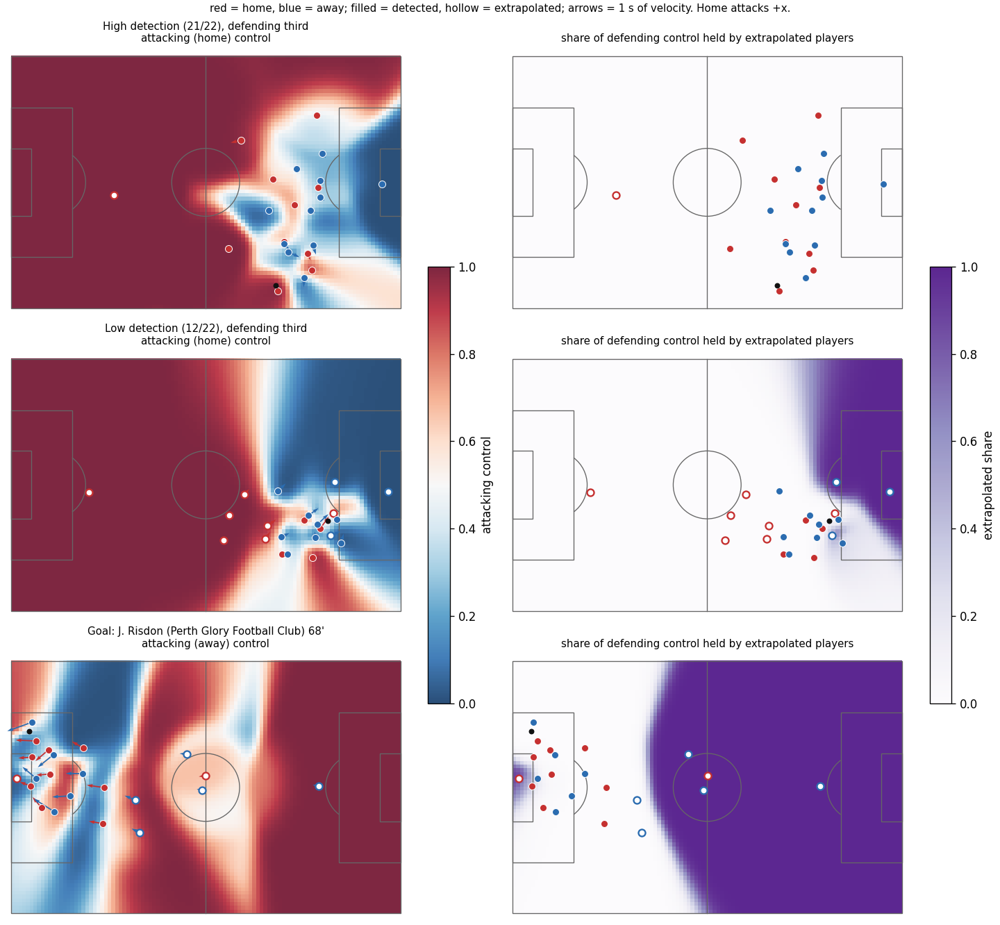
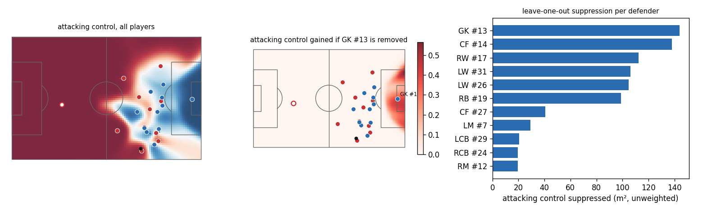

# Week 2: pitch-control base

Focal match Brisbane Roar FC vs Perth Glory Football Club (1925299); pass calibration over all 20 open-data matches. Module: `dsv/pitchcontrol.py`.

## Model as implemented
- Spearman time-to-intercept: t_react 0.7 s, sigma 0.45 s, lambda 4.3/s (goalkeepers x3.0), ball speed 15.0 m/s, integrated for 10.0 s after the ball arrives, dT 0.04 s, stop when all cells reach 99% control. 1 m grid (105 x 68).
- Each dT step is integrated exactly (exponential decay of the uncontrolled share), so total control never exceeds 1. Plain Euler overshoots on cells several players reach before the ball.
- vmax per player and half: v95 from detected runs, floored at the 25th percentile of the player's position group across all 20 matches. Goalkeepers use 5 m/s: their v95 (about 3 m/s) reflects how little they move, while their 99.9th-percentile speed is about 6 m/s.

| group | mean v95 | floor | mean vmax |
|---|---|---|---|
| Center Forward | 5.45 | 5.17 | 5.50 |
| Central Defender | 5.02 | 4.72 | 5.07 |
| Full Back | 5.40 | 5.16 | 5.47 |
| Goalkeeper | 3.06 | 2.72 | 5.00 |
| Midfield | 5.22 | 4.99 | 5.26 |
| Wide Attacker | 5.53 | 5.31 | 5.59 |
- `amax` is not used: the brief's arrival-time formula has no acceleration term. It returns in the Week 7 counterfactual motion model.
- Leave-one-out recomputes the model without defender i, which is the renormalization: the accrual ODE gives i's share to whoever else reaches each cell. All 11 removals plus the base run in one batched integration.

## Speed
- One frame, full grid: median 0.16 s (p90 0.19 s) over 200 frames.
- Leave-one-out (base + 11 removals): 2.0 s per frame.
- Whole match at 1 m and 10 fps would be about 2.2 h; Threat Conceded series will run at 2 to 5 fps or on a 2 m grid (Week 4 decision).

## Pass calibration (does the surface mean anything?)
For every completed or failed pass: control of the passing team at the ball's destination (ball position when the next possession starts, within 5 s), evaluated at the pass frame. A failed pass's destination is where an opponent took the ball, which favours the model slightly. Spearman (2017) validated the same way.

| vmax | passes | AUC | Brier | log loss | mean control, completed | mean control, failed |
|---|---|---|---|---|---|---|
| uniform 5 m/s | 15,114 | 0.930 | 0.073 | 0.263 | 0.86 | 0.32 |
| raw v95 | 15,114 | 0.931 | 0.073 | 0.254 | 0.85 | 0.35 |
| v95, group floor, GK 5 m/s | 15,114 | 0.930 | 0.074 | 0.261 | 0.85 | 0.34 |

- The surface separates completed from failed passes well, but it is underconfident in the middle: passes to a destination with 40-60% control complete 68% of the time (n=1,487). Some of this is selection (passers pick targets they expect to reach), but it also suggests the default parameters give defenders too much reach. Next: fit t_react, sigma and lambda on these passes with leave-one-match-out CV.
- Per-player vmax barely changes pass calibration. It is kept because it decides *who* covers a region, which matters for attribution rather than pass outcomes; the Week 5 sensitivity check should re-test it.

See [figs/w2_pass_calibration.png](../figs/w2_pass_calibration.png).

## How much defending control is extrapolated?
Over 200 random in-possession frames of the focal match, the share of the defending team's control held by players whose position is extrapolated:

| region | all frames | ball in defending third |
|---|---|---|
| within 20 m of the ball | 7.8% | 8.9% (n=52) |
| defending third | 66.7% | 16.1% (n=52) |
| whole pitch | 53.0% | 21.7% (n=52) |

## Sample frames
- frame 60623: High detection (21/22), defending third
- frame 140: Low detection (12/22), defending third
- frame 44283: Goal: J. Risdon (Perth Glory Football Club) 68'

## Leave-one-out on the high-detection frame
Unweighted suppression (m² of attacking control each defender removes); Week 3 weights this by danger and accessibility.

- GK #13: 144 m²
- CF #14: 138 m²
- RW #17: 112 m²
- LW #31: 106 m²
- LW #26: 105 m²
- RB #19: 99 m²
- CF #27: 41 m²
- LM #7: 29 m²
- LCB #29: 20 m²
- RCB #24: 20 m²
- RM #12: 19 m²

Unweighted, forwards rank high because they 'suppress' attacking control of empty space in the attacking team's own half. The goalkeeper ranks first because removing them hands over the goalmouth; once Week 3's danger surface weights this, keepers will dominate attribution unless Week 6 handles them separately.

## What raw control does not do yet
- The attacking team 'controls' its own empty half (the focal frames show 60-80% attacking control with the ball deep in the defending third). That is the space behind the ball the brief warns about; Week 3's danger surface and accessibility weight fix it.
- No offside: attackers beyond the last defender control space they cannot legally use. Handled in the accessibility weight.