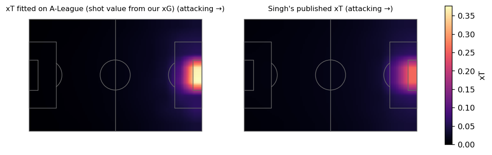
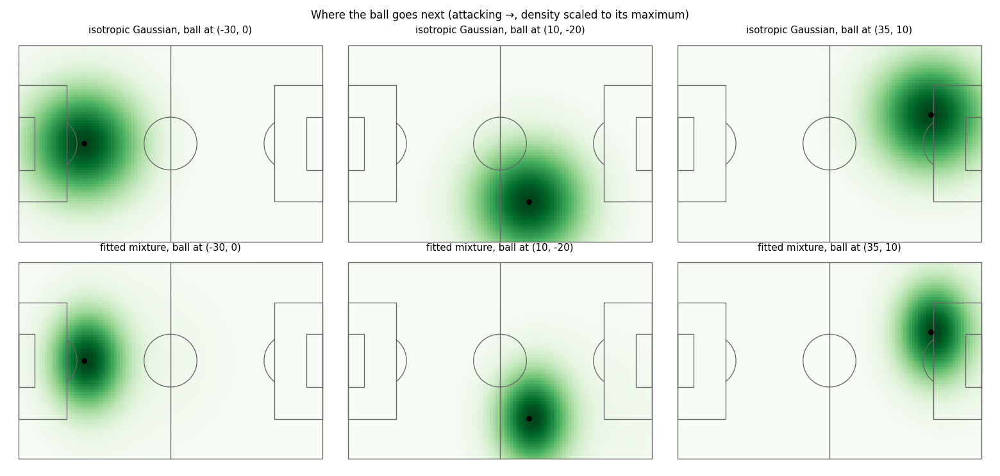
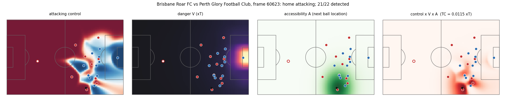

# Week 3: danger and accessibility

Threat Conceded weights the attacking team's pitch control by **danger** V(x) (how much a location is worth) and **accessibility** A(x | ball) (how likely the ball is to go there next). Both are fitted on the 20 SkillCorner open-data matches. Code: `dsv/value.py`; script: `scripts/05_value.py`.

## Danger: expected threat

Markov xT (Singh 2018) on 12 x 8 zones from 26,164 actions in player possessions (526 shots; 84% of moves kept the ball). Each possession contributes a carry (start to end, if at least 3 m) and a release (a shot, or a move to where the team's next possession starts; failed if the other team gets the ball). A zone's shot value is the xG model's value for a typical A-League shot from the zone centre (median blockers, keeper position and pressure; not a header), which avoids sparse zone-level goal counts.

The fitted grid correlates **0.99** with Karun Singh's published grid (fitted on European event data). Its maximum is higher (0.377 vs 0.257), in the zones just in front of goal, where its shot value comes from the xG model rather than counts.

Does a possession's starting xT rank whether that team possession produces a shot? (18,697 player possessions, 8% in team possessions that led to a shot; the A-League fit is out of fold by match.)

| model | AUC |
|---|---|
| xT fitted on A-League, interpolated (used for TC; out of fold) | 0.857 |
| xT fitted on A-League, zone value (out of fold) | 0.855 |
| Singh's published xT, interpolated | 0.856 |
| xG of a typical shot from here | 0.861 |
| distance to goal (closer = higher) | 0.861 |

All danger surfaces rank possessions within about 0.01 AUC of each other, and none clearly beats plain distance to goal: for this question, closeness to goal explains nearly everything, and finer xT grids (16 x 12, 24 x 16) do not change that. xT is kept as V because it values every location (including progression through midfield) in goal units. Whether the choice of V matters for Threat Conceded is tested where it counts, in the Week 5 shot-prediction gate, by rebuilding TC with each surface.

## Accessibility: where the ball goes next

16,785 transitions: the ball at a possession's release to the ball where the next possession (either team) starts, in the releasing team's attacking frame. Shots and gaps over 10 s are excluded. Each model is truncated to the pitch (closed form for axis-aligned Gaussians) and scored by held-out log-likelihood per transition (match-grouped 5-fold).

| model | held-out log-likelihood |
|---|---|
| isotropic Gaussian (Spearman-style) | -7.7063 |
| forward-shifted Gaussian | -7.6671 |
| 2-component mixture (selected) | -7.5744 |
| 3-component mixture | -7.5750 |

The selected model beats the isotropic Gaussian in 20 of 20 matches. Fitted on all transitions:

| component | weight | forward shift (m) | spread along x (m) | spread across (m) |
|---|---|---|---|---|
| 1 | 0.76 | 1.1 | 8.9 | 12.0 |
| 2 | 0.24 | 17.6 | 21.1 | 20.1 |

Most next touches are short and roughly centred on the ball; a minority are long and played forward. A single Gaussian has to compromise between the two.

## Putting it together on one frame

Attacking control uses `SKILLCORNER_OPEN_DATA` with attackers in offside positions (in the opponents' half, ahead of the ball and of the second-last defender) left out. Threat Conceded for the frame is the sum over cells of control x V x A. A sums to 1, so TC is the expected xT of where the ball goes next, counted only where the attack would control it.

Frame 60623 (21/22 players detected, 0 attacker(s) offside): TC = 0.0115 xT.

## Caveats

- xT is fitted on 20 matches; zones far from goal rest on many actions, zones in the box on few. The xG-based shot value keeps those zones stable.
- The transition model ignores who has the ball and the game state; Week 4 can test whether conditioning on phase of play helps.
- Offside uses the frame's positions as they are, including extrapolated ones, so a mistracked last defender can flip an attacker's status.
- V is the value of the ball being at x for the team in possession; TC does not yet account for what the attack does after reaching x beyond that.

Outputs: `data/derived/value_fit.json` (xT grid, transition parameters).