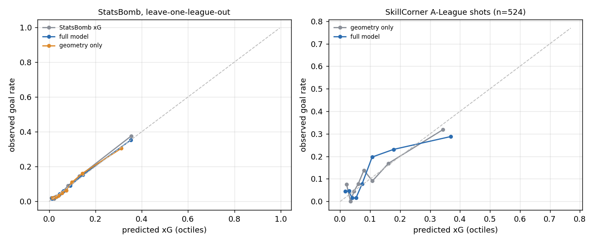

# xG for SkillCorner open-data shots

The SkillCorner open data has shots but no xG. This model is trained on **StatsBomb open data** (40,541 non-penalty shots with freeze frames from five seasons: Premier League 15/16, La Liga 15/16, Serie A 15/16, Ligue 1 15/16, Indian Super League 21/22) using only features that SkillCorner tracking also provides, then applied to the 526 SkillCorner shots. Code: `dsv/xg.py`; script: `scripts/04_xg.py`. StatsBomb data is used under its open-data terms, with attribution.

## Features

Shot distance and log-distance to the goal centre, visible goal angle (and its square), header (and distance x header), outfield opponents inside the shooter-posts triangle, the keeper's distance from the shot line and from the goal centre, distance to the nearest opponent, and opponents within 3 m. Logistic regression with a small ridge penalty.

## Validation on StatsBomb (leave one league out)

| model | log loss | Brier | AUC | ECE | xG / goals |
|---|---|---|---|---|---|
| geometry only | 0.2706 | 0.0764 | 0.770 | 0.007 | 3893 / 3884 |
| full model | 0.2568 | 0.0727 | 0.799 | 0.002 | 3892 / 3884 |
| StatsBomb xG (reference) | 0.2515 | 0.0707 | 0.811 | 0.005 | 3706 / 3884 |

Per held-out league (full model):

| league | shots | log loss | AUC | xG / goals |
|---|---|---|---|---|
| Premier League 15/16 | 9,817 | 0.2597 | 0.784 | 954 / 914 |
| La Liga 15/16 | 9,071 | 0.2654 | 0.816 | 936 / 945 |
| Serie A 15/16 | 9,877 | 0.2341 | 0.816 | 877 / 858 |
| Ligue 1 15/16 | 8,723 | 0.2582 | 0.800 | 849 / 852 |
| Indian Super League 21/22 | 3,053 | 0.2913 | 0.750 | 276 / 315 |

StatsBomb's own xG uses more information (shot technique, assist type, body position) and is shown as a reference, not as a baseline to beat.

## Applied to the SkillCorner shots

524 non-penalty shots, 60 goals (2 likely penalties are set to 0.76 xG and left out of these numbers). Total xG **56.7**; if the xG values were exactly right, 95% of seasons would produce 44–70 goals.

| model | log loss | Brier | AUC | ECE | total xG |
|---|---|---|---|---|---|
| full model | 0.3148 | 0.0920 | 0.755 | 0.035 | 56.7 |
| geometry only | 0.3298 | 0.0954 | 0.715 | 0.033 | 55.9 |
| constant (in-sample goal rate) | 0.3558 | 0.1014 | 0.500 | 0.000 | 60.0 |

The constant model uses the A-League goal rate itself, so it is an in-sample reference. With 60 goals these numbers are noisy: treat differences in the second decimal of AUC as noise.

**Extrapolated positions.** Shots split by whether any opponent within 20 m of the shooter was extrapolated at the shot frame:

| shots | n | goals | xG | log loss | AUC |
|---|---|---|---|---|---|
| no nearby opponent extrapolated | 294 | 29 | 30.1 | 0.2767 | 0.791 |
| some nearby opponents extrapolated | 230 | 31 | 26.6 | 0.3634 | 0.720 |

## Caveats

- Trained on European top flights (2015/16) plus one Indian Super League season; the A-League check above is the only evidence it transfers. In the held-out lower league (ISL) goals exceed xG by 14%, and on the A-League shots by 6%: the model may slightly undervalue chances outside the European top flights.
- SkillCorner positions at the shot frame can be extrapolated. When any opponent near the shooter is, the model ranks shots less well and undercounts goals (split above).
- Penalties are excluded from the model. SkillCorner does not label them; two shots from the spot with a short possession are treated as penalties.
- Goals are possessions followed by `goal_for`. Five of the 66 goals in the final scores are not on a shot-tagged possession and so are missing here (see the README).

Outputs: `data/derived/skillcorner_shots_xg.csv` (one row per SkillCorner shot), `data/derived/xg_model.json` (coefficients).