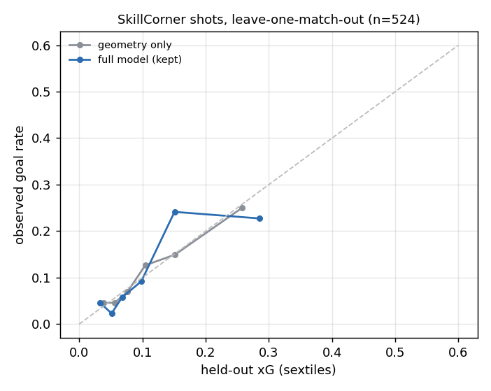

# xG for the SkillCorner open-data shots

The SkillCorner open data has shots but no xG, and the Analytics Cup allows only the SkillCorner data provided for the event, so the model is fitted on the competition's own shots: 524 non-penalty shots and 60 goals in 20 A-League matches, with features from the tracking at the shot frame. Code: `dsv/xg.py`; script: `scripts/04_xg.py`.

## Features

Shot distance and log-distance to the goal centre, visible goal angle (and its square), header (and distance x header), outfield opponents inside the shooter-posts triangle, the keeper's distance from the shot line and from the goal centre, distance to the nearest opponent, and opponents within 3 m. The geometry-only model keeps the first four. Logistic regression with a ridge penalty.

## Which model (held out by match)

| model | ridge | log loss | Brier | AUC | ECE | total xG |
|---|---|---|---|---|---|---|
| geometry only | 0.0001 | 0.3396 | 0.0988 | 0.681 | 0.030 | 59.5 |
| geometry only | 0.01 | 0.3342 | 0.0972 | 0.692 | 0.007 | 59.9 |
| geometry only | 0.1 | 0.3368 | 0.0975 | 0.692 | 0.028 | 60.0 |
| full model | 0.0001 | 0.3354 | 0.0977 | 0.706 | 0.046 | 59.6 |
| full model | 0.01 | 0.3276 | 0.0959 | 0.723 | 0.029 | 60.0 |
| full model | 0.1 | 0.3319 | 0.0963 | 0.718 | 0.035 | 60.0 |
| constant (goal rate of the other matches) |  | 0.3586 | 0.1020 | 0.308 | 0.000 | 60.0 |

Kept: **full model**, ridge 0.01 (lowest held-out log loss). Held-out xG totals 60.0 for 60 goals; if the xG values were exactly right, 95% of samples like this would produce 47–74 goals. With 60 goals, differences in the second decimal of AUC are noise.

**Extrapolated positions.** Shots split by whether any opponent within 20 m of the shooter was extrapolated at the shot frame (held-out xG):

| shots | n | goals | xG | log loss | AUC |
|---|---|---|---|---|---|
| no nearby opponent extrapolated | 294 | 29 | 32.4 | 0.2926 | 0.754 |
| some nearby opponents extrapolated | 230 | 31 | 27.6 | 0.3724 | 0.690 |

## Caveats

- 60 goals is a small sample for an xG model; the ridge penalty and the held-out choice keep it simple. The model is used for its shape (how danger rises toward goal), as the danger map and as the value of a shot in expected threat, more than for single-shot estimates.
- SkillCorner positions at the shot frame can be extrapolated (split above).
- Penalties are excluded from the model and set to 0.76 xG. SkillCorner does not label them; shots from the spot at the start of a short possession are treated as penalties.
- Goals are possessions followed by `goal_for`. A few goals in the final scores are not on a shot-tagged possession and so are missing here (see the README).

Outputs: `data/derived/skillcorner_shots_xg.csv` (one row per shot, in-sample and held-out xG), `data/derived/xg_model.json` (coefficients).