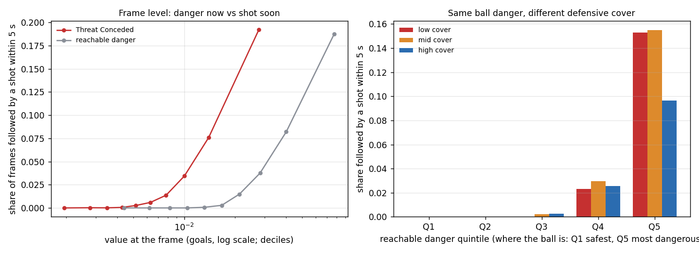
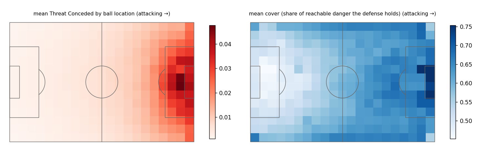
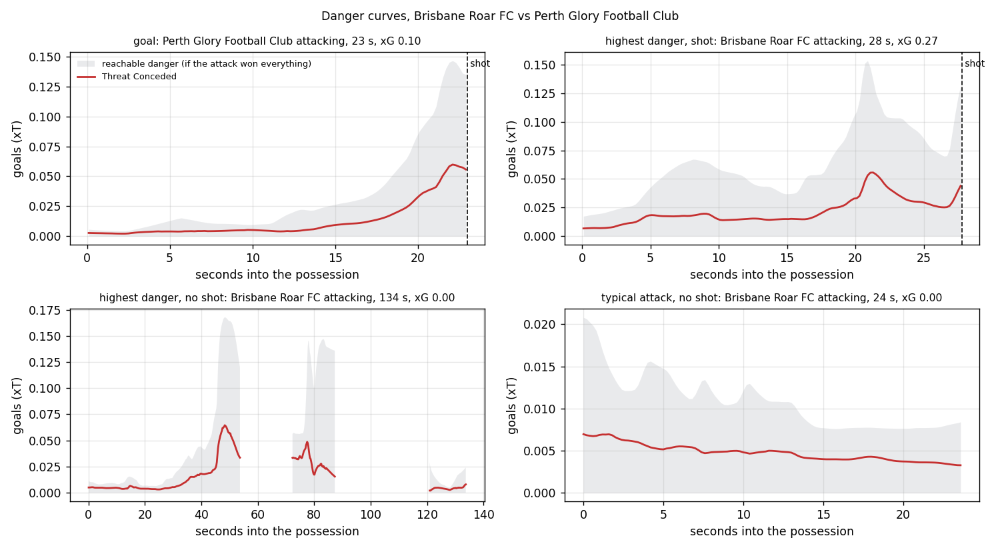
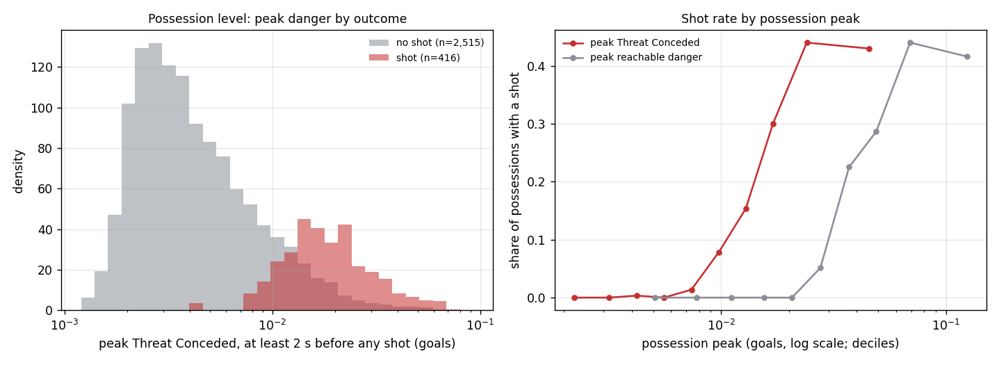
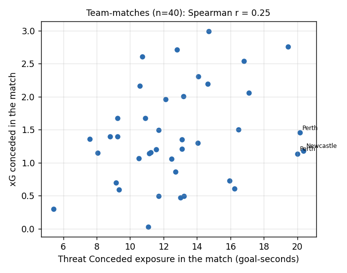

# Threat Conceded over whole matches

Threat Conceded computed for every team possession of all 20 SkillCorner open-data matches, 5 times per second: **308,004 frames** in **3,998 possessions**. Module: `dsv/threat.py`; script: `scripts/06_threat.py`. This is a descriptive first look; the formal shot-prediction test adds controls and cross-validation.

## What is measured

| level | measure | definition | football meaning |
|---|---|---|---|
| frame | **Threat Conceded (TC)** | Σ A(x \| ball) · PC_att(x) · xT(x) | danger the defense is allowing right now, in goals |
| frame | **reachable danger (RD)** | Σ A(x \| ball) · xT(x) | danger if the attack won every spot: depends only on where the ball is |
| frame | **cover** | 1 − TC / RD | share of the reachable danger the defense controls |
| possession | **peak** | highest TC in the possession, at least 2 s before any shot | the worst moment the defense allowed, before the shot itself |
| possession | **exposure** | Σ TC × time between frames | how much danger, for how long (goal-seconds) |
| team-match | **TC exposure** | sum of exposure over the opponent's possessions | total danger allowed in the match |

## Computing it fast enough

Full resolution (1 m grid, 0.04 s steps) takes about a quarter of a second per frame, two hours per match. The match-long computation uses a 2 m grid, 0.08 s steps, and starts each spot's race just before the first player could plausibly arrive, dropping spots once decided. Checked against the full computation on 92 sampled frames: median relative error **0.10%**, maximum 0.45%; 6 ms vs 212 ms per frame.

## Frame by frame

Typical values: TC median 0.0057 (90th percentile 0.0172); reachable danger median 0.0148; the defense covers a median 59% of the danger within reach.

How well does the value at a moment rank whether the attacking team shoots within the next 5 s? (3.3% of frames are followed by a shot.)

| measure | AUC |
|---|---|
| Threat Conceded | 0.900 |
| reachable danger (ball location only) | 0.904 |
| ball distance to goal (closer = higher) | 0.917 |

TC minus reachable danger: -0.004 AUC (95% match-bootstrap interval -0.008 to +0.002). Frames within a possession are strongly correlated, so these are descriptive.

**Holding ball location fixed.** Frames are split into five bands of reachable danger (where the ball is), then within each band into thirds by cover. Share of frames followed by a shot within 5 s:

| ball danger band | low cover | mid cover | high cover |
|---|---|---|---|
| Q1 | 0.0% | 0.0% | 0.0% |
| Q2 | 0.0% | 0.0% | 0.0% |
| Q3 | 0.0% | 0.2% | 0.3% |
| Q4 | 2.3% | 3.0% | 2.6% |
| Q5 | 15.3% | 15.5% | 9.7% |

**By phase of play** (the attacking team's phase):

| phase | frames | mean TC | mean reachable danger | mean cover | shot within 5 s |
|---|---|---|---|---|---|
| set_play | 6,187 | 0.0215 | 0.0520 | 59% | 18.7% |
| quick_break | 3,898 | 0.0167 | 0.0463 | 64% | 24.6% |
| finish | 59,128 | 0.0144 | 0.0401 | 63% | 9.5% |
| transition | 9,851 | 0.0089 | 0.0251 | 64% | 10.9% |
| direct | 3,972 | 0.0058 | 0.0187 | 64% | 2.0% |
| chaotic | 16,801 | 0.0057 | 0.0163 | 61% | 0.0% |
| create | 109,072 | 0.0054 | 0.0134 | 57% | 0.6% |
| build_up | 45,632 | 0.0027 | 0.0057 | 52% | 0.1% |

## Possession by possession

3,998 possessions; 452 with a shot, 62 with a goal. 2,931 have frames at least 2 s before any shot (the rest are very short) and are used below.

| measure (≥ 2 s before any shot) | AUC for a shot in the possession |
|---|---|
| peak Threat Conceded | 0.871 |
| peak reachable danger (ball location only) | 0.868 |

Peak TC minus peak reachable danger: +0.002 AUC (95% match-bootstrap interval -0.003 to +0.008).

Among possessions with a shot, peak TC and the possession's xG have a Spearman correlation of 0.27.

**Holding ball location fixed.** Possessions split into thirds by peak reachable danger, then by how much of it the attack controlled at its peak (peak TC / peak reachable danger). Share with a shot:

| ball danger third | defense covered most | middle | defense covered least |
|---|---|---|---|
| low | 0.0% (n=326) | 0.0% (n=325) | 0.0% (n=326) |
| mid | 5.5% (n=326) | 6.2% (n=325) | 5.5% (n=326) |
| high | 29.1% (n=326) | 38.2% (n=325) | 43.3% (n=326) |

## Team by match

40 team-matches. Spearman correlation of a team's Threat Conceded exposure in a match with its xG conceded: **0.25**; with shots conceded: 0.54. Exposure grows with how long the opponent has the ball, which also drives shots, so this is not yet a measure of defensive quality per possession.

## Caveats

- Descriptive only: no controls, no cross-validation, frames within a possession are not independent.
- Velocities are smoothed over ±0.3 s, so a frame's state uses 0.3 s of future positions.
- Possessions and outcomes come from the SkillCorner event layer; goals not on a shot-tagged possession are missed (see the README).
- About two fifths of the defense's weighted control comes from players whose positions are extrapolated (frame median 33%).

Outputs: `data/derived/threat/<match>_frames.csv.gz` (frame level), `data/derived/threat_possessions.csv`, `data/derived/threat_team_matches.csv`.