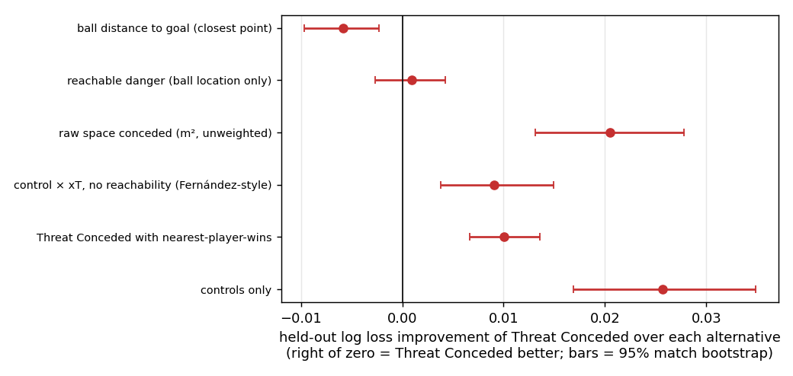
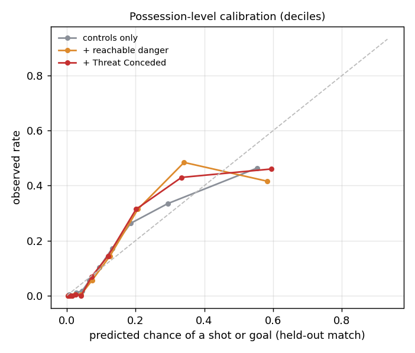

# Does Threat Conceded predict shots?

**Result: NOT PASSED** the pre-declared test: Threat Conceded must beat every baseline on held-out log loss, with the 95% match-bootstrap interval of the difference below zero.

Unit: 2,931 team possessions from 20 matches that have frames at least 2 s before any shot; 416 (14.2%) produced a shot or goal. Each model is a logistic regression with the same controls (log possession length, first phase of play, mean defenders goal-side, where the possession started) plus one danger measure, taken as its peak at least 2 s before any shot so the shot itself cannot drive it. Every prediction is for a match the model did not see (leave-one-match-out). Script: `scripts/07_validation.py`.

## Main comparison

| model (controls + ...) | log loss | Brier | AUC | ECE |
|---|---|---|---|---|
| controls only | 0.3146 | 0.0999 | 0.842 | 0.032 |
| ball distance to goal (closest point) | 0.2831 | 0.0953 | 0.885 | 0.056 |
| reachable danger (ball location only) | 0.2899 | 0.0967 | 0.879 | 0.053 |
| raw space conceded (m², unweighted) | 0.3094 | 0.0999 | 0.850 | 0.037 |
| control × xT, no reachability (Fernández-style) | 0.2980 | 0.0972 | 0.863 | 0.032 |
| Threat Conceded with nearest-player-wins | 0.2990 | 0.0978 | 0.872 | 0.045 |
| **Threat Conceded** | 0.2890 | 0.0957 | 0.882 | 0.051 |

Threat Conceded minus each alternative (negative log loss and positive AUC favour Threat Conceded):

| vs | Δ log loss [95% interval] | Δ AUC [95% interval] |
|---|---|---|
| ball distance to goal (closest point) | +0.0059 [+0.0023, +0.0097] | -0.004 [-0.008, +0.000] |
| reachable danger (ball location only) | -0.0009 [-0.0043, +0.0027] | +0.003 [-0.001, +0.007] |
| raw space conceded (m², unweighted) | -0.0205 [-0.0278, -0.0131] | +0.031 [+0.023, +0.040] |
| control × xT, no reachability (Fernández-style) | -0.0091 [-0.0150, -0.0038] | +0.019 [+0.013, +0.025] |
| Threat Conceded with nearest-player-wins | -0.0100 [-0.0136, -0.0066] | +0.010 [+0.006, +0.014] |
| controls only | -0.0257 [-0.0349, -0.0169] | +0.039 [+0.028, +0.051] |

## Does the defense's shape add anything beyond where the ball is?

Reachable danger depends only on the ball's location. Adding Threat Conceded on top of it (same controls) changes held-out log loss by -0.0012 [-0.0034, +0.0013] and AUC by +0.002 [+0.000, +0.005]. An interval below zero for log loss means the defense's control of the space adds information that ball location alone does not have.

## Post hoc: after seeing the main result

These two analyses were added after the pre-declared test failed. They do not change its verdict.

**A. On top of the best baseline.** Controls plus ball distance to goal, then adding ball-location danger or Threat Conceded. If Threat Conceded adds more than ball-location danger, the extra comes from the defense's control of the space.

| model (controls + ball distance + ...) | log loss | AUC |
|---|---|---|
| nothing more | 0.2831 | 0.885 |
| reachable danger | 0.2770 | 0.891 |
| Threat Conceded | 0.2835 | 0.885 |

| comparison | Δ log loss [95% interval] | Δ AUC [95% interval] |
|---|---|---|
| + reachable danger vs ball distance alone | -0.0061 [-0.0087, -0.0036] | +0.005 [+0.003, +0.008] |
| + Threat Conceded vs ball distance alone | +0.0004 [+0.0001, +0.0008] | -0.000 [-0.001, -0.000] |
| + Threat Conceded vs + reachable danger | +0.0065 [+0.0039, +0.0092] | -0.006 [-0.009, -0.003] |

**B. Danger surface chosen fairly.** In each fold the danger surface (A-League xT or xG from here) is chosen on the training matches only, then the held-out match is predicted with it. Chosen: xG from here in 20 of 20 folds. Held-out log loss 0.2803, AUC 0.886. Against ball distance to goal: Δ log loss -0.0028 [-0.0059, +0.0004], Δ AUC +0.001 [-0.003, +0.004].

**C. Is the xG-from-here gain the defense, or a better ball-location map?** Reachable danger built with the same map (ball position only, no pitch control) against Threat Conceded built with it:

| model (controls + ...) | log loss | AUC |
|---|---|---|
| nothing more | 0.3146 | 0.842 |
| reachable danger (xG from here) | 0.2840 | 0.882 |
| Threat Conceded (xG from here) | 0.2803 | 0.886 |

| comparison | Δ log loss [95% interval] | Δ AUC [95% interval] |
|---|---|---|
| Threat Conceded vs its reachable danger (separately) | -0.0037 [-0.0065, -0.0007] | +0.004 [+0.001, +0.007] |
| reachable danger + Threat Conceded vs reachable danger alone | -0.0034 [-0.0062, -0.0005] | +0.004 [+0.001, +0.007] |
| reachable danger alone vs ball distance | +0.0009 [-0.0002, +0.0020] | -0.003 [-0.005, -0.002] |

## Sensitivity

Same test, rebuilding Threat Conceded with other ingredients:

| version | log loss | AUC |
|---|---|---|
| Threat Conceded (A-League xT, fitted next-ball model) | 0.2890 | 0.882 |
| with xG-from-here as danger | 0.2803 | 0.886 |
| with a single-Gaussian next-ball model | 0.2882 | 0.881 |

**Tracking quality.** Restricted to possessions where extrapolated players hold at most the median share (38%) of the defense's weighted control:

| model | log loss | AUC |
|---|---|---|
| controls only | 0.3937 | 0.822 |
| + reachable danger | 0.3790 | 0.842 |
| + Threat Conceded | 0.3781 | 0.843 |

## xG

Among possessions with a shot, Spearman correlation with the possession's xG: Threat Conceded 0.34; reachable danger 0.29.

| peak Threat Conceded decile | possessions | shot or goal | share of all xG |
|---|---|---|---|
| 1 | 294 | 0.0% | 0.0% |
| 2 | 293 | 0.0% | 0.0% |
| 3 | 293 | 0.3% | 0.1% |
| 4 | 293 | 0.0% | 0.0% |
| 5 | 293 | 1.4% | 1.0% |
| 6 | 293 | 7.2% | 3.3% |
| 7 | 293 | 16.0% | 7.1% |
| 8 | 293 | 30.4% | 17.1% |
| 9 | 293 | 43.7% | 32.8% |
| 10 | 293 | 43.0% | 38.6% |

## Frame level

308,004 frames; 3.3% are followed by a shot within 5 s. Same approach (controls: time into the possession, defenders goal-side, ball position, phase), leave-one-match-out:

| model (controls + ...) | log loss | AUC |
|---|---|---|
| controls only | 0.1111 | 0.880 |
| ball distance to goal | 0.0994 | 0.919 |
| reachable danger (ball location only) | 0.1034 | 0.910 |
| raw space conceded | 0.1110 | 0.879 |
| control × xT, no reachability | 0.1096 | 0.885 |
| Threat Conceded with nearest-player-wins | 0.1081 | 0.894 |
| Threat Conceded | 0.1039 | 0.907 |

Threat Conceded minus each alternative (at frame level the AUC difference has no interval):

| vs | Δ log loss [95% interval] | Δ AUC |
|---|---|---|
| ball distance to goal | +0.0045 [+0.0022, +0.0068] | -0.012 |
| reachable danger (ball location only) | +0.0005 [-0.0012, +0.0021] | -0.003 |
| raw space conceded | -0.0071 [-0.0088, -0.0054] | +0.028 |
| control × xT, no reachability | -0.0057 [-0.0069, -0.0044] | +0.022 |
| Threat Conceded with nearest-player-wins | -0.0042 [-0.0051, -0.0033] | +0.013 |

Frames within a possession are strongly correlated; the match bootstrap accounts for this at the match level.

## Caveats

- The baselines share the same pitch-control and next-ball computations where relevant, so they isolate one ingredient at a time.
- Very short possessions (no frame 2 s before a shot or the end) are excluded.
- Velocities use ±0.3 s of smoothing; the 2 s lookback keeps this well clear of the shot.
- 20 matches: differences are judged by match-bootstrap intervals, not by point estimates.