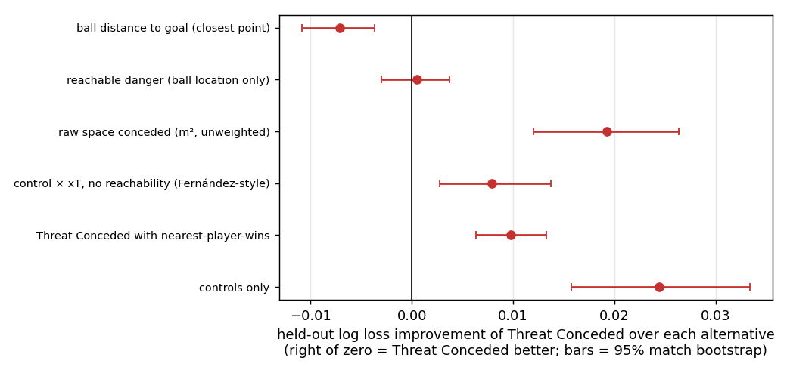
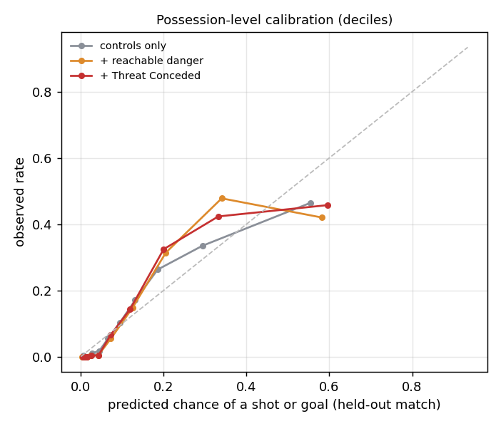

# Does Threat Conceded predict shots?

**Result: NOT PASSED** the pre-declared test: Threat Conceded must beat every baseline on held-out log loss, with the 95% match-bootstrap interval of the difference below zero.

Unit: 2,931 team possessions from 20 matches that have frames at least 2 s before any shot; 416 (14.2%) produced a shot or goal. Each model is a logistic regression with the same controls (log possession length, first phase of play, mean defenders goal-side, where the possession started) plus one danger measure, taken as its peak at least 2 s before any shot so the shot itself cannot drive it. Every prediction is for a match the model did not see (leave-one-match-out). Script: `scripts/07_validation.py`.

## Main comparison

| model (controls + ...) | log loss | Brier | AUC | ECE |
|---|---|---|---|---|
| controls only | 0.3146 | 0.0999 | 0.842 | 0.032 |
| ball distance to goal (closest point) | 0.2831 | 0.0953 | 0.885 | 0.056 |
| reachable danger (ball location only) | 0.2907 | 0.0968 | 0.878 | 0.054 |
| raw space conceded (m², unweighted) | 0.3094 | 0.0999 | 0.850 | 0.037 |
| control × xT, no reachability (Fernández-style) | 0.2981 | 0.0972 | 0.863 | 0.033 |
| Threat Conceded with nearest-player-wins | 0.3000 | 0.0980 | 0.871 | 0.047 |
| **Threat Conceded** | 0.2902 | 0.0960 | 0.881 | 0.052 |

Threat Conceded minus each alternative (negative log loss and positive AUC favour Threat Conceded):

| vs | Δ log loss [95% interval] | Δ AUC [95% interval] |
|---|---|---|
| ball distance to goal (closest point) | +0.0071 [+0.0036, +0.0108] | -0.005 [-0.009, -0.001] |
| reachable danger (ball location only) | -0.0005 [-0.0037, +0.0030] | +0.003 [-0.001, +0.006] |
| raw space conceded (m², unweighted) | -0.0192 [-0.0263, -0.0120] | +0.030 [+0.022, +0.039] |
| control × xT, no reachability (Fernández-style) | -0.0079 [-0.0137, -0.0028] | +0.017 [+0.012, +0.024] |
| Threat Conceded with nearest-player-wins | -0.0098 [-0.0133, -0.0063] | +0.010 [+0.006, +0.014] |
| controls only | -0.0244 [-0.0333, -0.0157] | +0.038 [+0.027, +0.049] |

## Does the defense's shape add anything beyond where the ball is?

Reachable danger depends only on the ball's location. Adding Threat Conceded on top of it (same controls) changes held-out log loss by -0.0008 [-0.0028, +0.0014] and AUC by +0.002 [-0.000, +0.004]. An interval below zero for log loss means the defense's control of the space adds information that ball location alone does not have.

## Post hoc: after seeing the main result

These two analyses were added after the pre-declared test failed. They do not change its verdict.

**A. On top of the best baseline.** Controls plus ball distance to goal, then adding ball-location danger or Threat Conceded. If Threat Conceded adds more than ball-location danger, the extra comes from the defense's control of the space.

| model (controls + ball distance + ...) | log loss | AUC |
|---|---|---|
| nothing more | 0.2831 | 0.885 |
| reachable danger | 0.2761 | 0.891 |
| Threat Conceded | 0.2834 | 0.885 |

| comparison | Δ log loss [95% interval] | Δ AUC [95% interval] |
|---|---|---|
| + reachable danger vs ball distance alone | -0.0070 [-0.0098, -0.0043] | +0.006 [+0.003, +0.009] |
| + Threat Conceded vs ball distance alone | +0.0003 [+0.0001, +0.0006] | -0.000 [-0.001, -0.000] |
| + Threat Conceded vs + reachable danger | +0.0073 [+0.0046, +0.0100] | -0.006 [-0.009, -0.003] |

**B. Danger surface chosen fairly.** In each fold the danger surface (A-League xT, Singh's xT or xG from here) is chosen on the training matches only, then the held-out match is predicted with it. Chosen: xG from here in 20 of 20 folds. Held-out log loss 0.2768, AUC 0.888. Against ball distance to goal: Δ log loss -0.0063 [-0.0093, -0.0033], Δ AUC +0.003 [-0.001, +0.006].

**C. Is the xG-from-here gain the defense, or a better ball-location map?** Reachable danger built with the same map (ball position only, no pitch control) against Threat Conceded built with it:

| model (controls + ...) | log loss | AUC |
|---|---|---|
| nothing more | 0.3146 | 0.842 |
| reachable danger (xG from here) | 0.2808 | 0.885 |
| Threat Conceded (xG from here) | 0.2768 | 0.888 |

| comparison | Δ log loss [95% interval] | Δ AUC [95% interval] |
|---|---|---|
| Threat Conceded vs its reachable danger (separately) | -0.0040 [-0.0066, -0.0014] | +0.003 [+0.000, +0.007] |
| reachable danger + Threat Conceded vs reachable danger alone | -0.0038 [-0.0063, -0.0012] | +0.003 [+0.000, +0.006] |
| reachable danger alone vs ball distance | -0.0023 [-0.0033, -0.0013] | -0.001 [-0.002, -0.000] |

## Sensitivity

Same test, rebuilding Threat Conceded with other ingredients:

| version | log loss | AUC |
|---|---|---|
| Threat Conceded (A-League xT, fitted next-ball model) | 0.2902 | 0.881 |
| with Singh's published xT | 0.2944 | 0.878 |
| with xG-from-here as danger | 0.2768 | 0.888 |
| with a single-Gaussian next-ball model | 0.2891 | 0.880 |

**Tracking quality.** Restricted to possessions where extrapolated players hold at most the median share (39%) of the defense's weighted control:

| model | log loss | AUC |
|---|---|---|
| controls only | 0.3932 | 0.821 |
| + reachable danger | 0.3775 | 0.842 |
| + Threat Conceded | 0.3770 | 0.843 |

## xG

Among possessions with a shot, Spearman correlation with the possession's xG: Threat Conceded 0.27; reachable danger 0.22.

| peak Threat Conceded decile | possessions | shot or goal | share of all xG |
|---|---|---|---|
| 1 | 294 | 0.0% | 0.0% |
| 2 | 293 | 0.0% | 0.0% |
| 3 | 293 | 0.3% | 0.0% |
| 4 | 293 | 0.0% | 0.0% |
| 5 | 293 | 1.4% | 1.1% |
| 6 | 293 | 7.8% | 3.2% |
| 7 | 293 | 15.4% | 6.6% |
| 8 | 293 | 30.0% | 17.7% |
| 9 | 293 | 44.0% | 32.8% |
| 10 | 293 | 43.0% | 38.5% |

## Frame level

308,004 frames; 3.3% are followed by a shot within 5 s. Same approach (controls: time into the possession, defenders goal-side, ball position, phase), leave-one-match-out:

| model (controls + ...) | log loss | AUC |
|---|---|---|
| controls only | 0.1111 | 0.880 |
| ball distance to goal | 0.0994 | 0.919 |
| reachable danger (ball location only) | 0.1039 | 0.908 |
| raw space conceded | 0.1110 | 0.879 |
| control × xT, no reachability | 0.1096 | 0.885 |
| Threat Conceded with nearest-player-wins | 0.1084 | 0.893 |
| Threat Conceded | 0.1044 | 0.906 |

Threat Conceded minus each alternative (at frame level the AUC difference has no interval):

| vs | Δ log loss [95% interval] | Δ AUC |
|---|---|---|
| ball distance to goal | +0.0050 [+0.0027, +0.0074] | -0.014 |
| reachable danger (ball location only) | +0.0006 [-0.0011, +0.0021] | -0.003 |
| raw space conceded | -0.0066 [-0.0082, -0.0050] | +0.026 |
| control × xT, no reachability | -0.0052 [-0.0063, -0.0040] | +0.020 |
| Threat Conceded with nearest-player-wins | -0.0040 [-0.0049, -0.0032] | +0.013 |

Frames within a possession are strongly correlated; the match bootstrap accounts for this at the match level.

## Caveats

- The baselines share the same pitch-control and next-ball computations where relevant, so they isolate one ingredient at a time.
- Very short possessions (no frame 2 s before a shot or the end) are excluded.
- Velocities use ±0.3 s of smoothing; the 2 s lookback keeps this well clear of the shot.
- 20 matches: differences are judged by match-bootstrap intervals, not by point estimates.