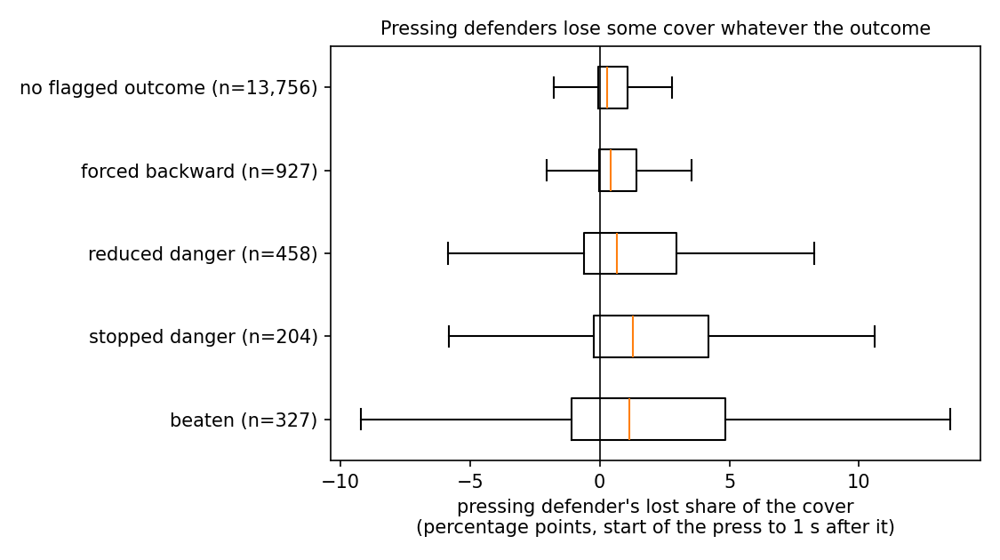

# Does blame point at the beaten defender?

Each defender's share of the cover is the part of the reachable shooting danger (xG-from-here map) they control; the shares add up to the team's cover (`dsv/attribution.py`). Blame splits a loss of cover across the defenders whose share fell. SkillCorner's dynamic events independently flag on-ball engagements in which the pressing defender was beaten, and name the defender. Script: `scripts/11_attribution.py`.

15,672 engagements during an opponent possession, from the start of the engagement to 1 s after it (or the end of the possession). Means with 95% match-bootstrap intervals:

| SkillCorner outcome | engagements | pressing defender's lost share (pp) | blamed most | their part of the team's drop | team's uncovered share (log change) |
|---|---|---|---|---|---|
| beaten | 327 | +1.7 [+1.0, +2.3] | 13% [9%, 18%] | 12% | +0.28 [+0.22, +0.33] |
| stopped danger | 204 | +2.5 [+2.2, +2.9] | 18% [14%, 21%] | 17% | +0.20 [+0.15, +0.25] |
| reduced danger | 458 | +1.7 [+1.4, +2.1] | 14% [11%, 16%] | 14% | +0.15 [+0.12, +0.19] |
| forced backward | 927 | +1.0 [+0.8, +1.2] | 5% [3%, 7%] | 8% | +0.21 [+0.19, +0.24] |
| no flagged outcome | 13,756 | +0.7 [+0.7, +0.8] | 7% [6%, 7%] | 8% | +0.05 [+0.04, +0.06] |

**Separating beaten from other engagements** (AUC, 0.5 = no information):

- pressing defender's own loss of cover: 0.561
- team's loss of cover: 0.648
- ball danger gained: 0.824

Logistic model of "beaten", held out by match: the ball's gain in danger, the team's change in uncovered share and the defender's starting share give log loss 0.0774; adding the pressing defender's own loss of cover gives 0.0759 (difference -0.0015 [-0.0023, -0.0007]; AUC +0.010 [+0.008, +0.013]).

## Reading

- **The team side agrees with SkillCorner.** When the presser is beaten, the share of the shooting danger the whole defense leaves uncovered rises far more than after any other kind of engagement.
- **The individual side is weak.** The pressing defender loses some of their share in every flagged outcome, most of all when they stopped the danger (stepping in to win the ball also leaves space). Their own loss separates "beaten" from other engagements only slightly (AUC above), and they are the defender blamed most in about one beaten engagement in eight.
- **Where the lost cover goes.** After a beaten press, most of the cover lost belongs to teammates: the space that opens is behind the presser, where others should be covering. Blame by lost share therefore points at the cover structure around a press, not at the presser alone. Judging the press itself needs the counterfactual of Layer 3 (what if they had held position), not attribution.

SkillCorner's flags are themselves computed from tracking geometry, so agreement shows the two constructions see the same events, not that either is ground truth.

