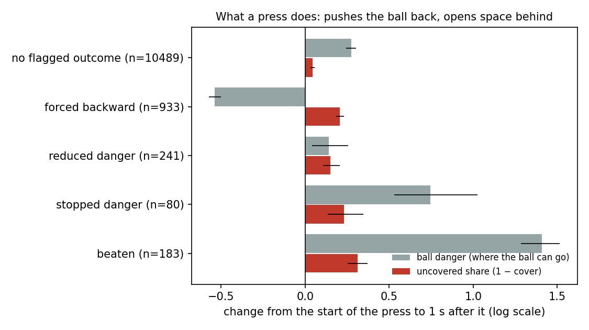
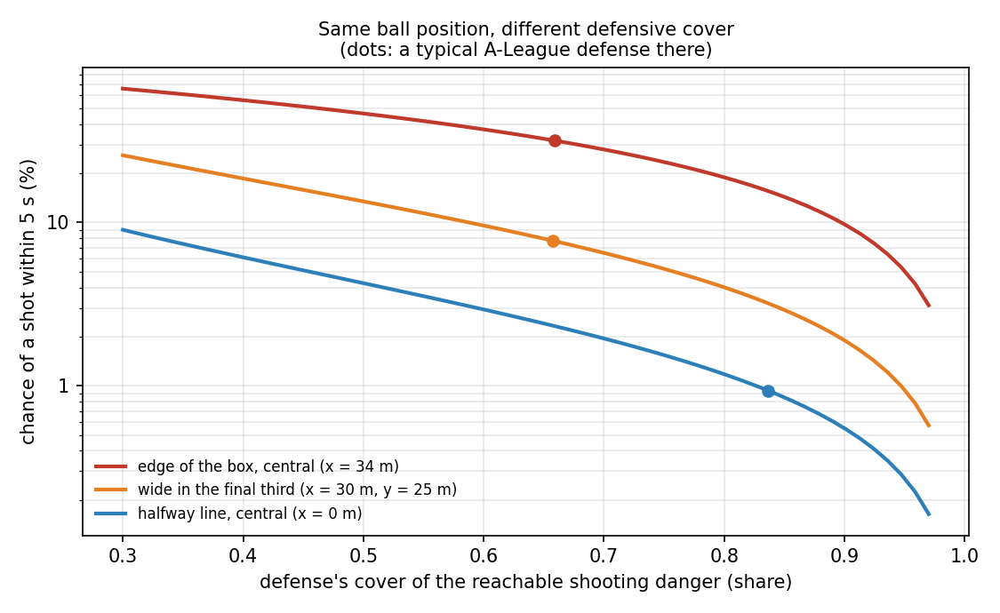

# The two-part model: the ball's situation and the defense's cover

**Status: exploratory.** These analyses were run on the 20 SkillCorner matches after the pre-declared Week 5 test failed ([w5_validation.md](w5_validation.md)). The confirmation on independent data, pre-registered before it was run, is [w6_confirmation.md](w6_confirmation.md). Script: `scripts/08_two_part.py`; model: `dsv/defense.py`.

## 1. Why the product failed

Threat Conceded multiplies reachable danger (where the ball is and can go) by the share the defense leaves uncovered, so log TC = log RD + log(1 − cover). In a model of a shot within 5 s, that forces both to carry the same coefficient. Fitted freely (with time in possession, defenders goal-side and phase controls; 95% match-bootstrap intervals):

| danger map | coefficient on log RD (situation) | coefficient on log(1 − cover) (defense) | ratio defense / situation |
|---|---|---|---|
| xT | 2.32 [2.17, 2.48] | 0.96 [0.69, 1.32] | 0.30 to 0.55 |
| xG from here | 1.31 [1.22, 1.41] | 0.96 [0.75, 1.19] | 0.56 to 0.93 |

The product is right only if the ratio is 1. The defense's share matters, but with a weight of its own, so it has to enter the model separately.

## 2. Cover with its own coefficient

Held out by match. The baseline describes where the ball is flexibly (distance and its square, goal-mouth angle, |y|, x, log reachable danger under both maps) with time in possession, defenders goal-side and phase of play. Negative differences mean cover helps.

| outcome | cover | frames (rate) | log loss without → with | difference [95%] | AUC without → with |
|---|---|---|---|---|---|
| shot within 5 s | xT | 308,004 (3.3%) | 0.0958 → 0.0936 | -0.0023 [-0.0031, -0.0014] | 0.923 → 0.929 |
| shot within 5 s | xG from here | 308,004 (3.3%) | 0.0958 → 0.0933 | -0.0025 [-0.0034, -0.0017] | 0.923 → 0.929 |
| ball into the box within 5 s | xT | 288,896 (5.0%) | 0.1380 → 0.1340 | -0.0039 [-0.0053, -0.0025] | 0.898 → 0.907 |
| ball into the box within 5 s | xG from here | 288,896 (5.0%) | 0.1380 → 0.1347 | -0.0033 [-0.0045, -0.0021] | 0.898 → 0.905 |

**Per possession** (2,931 possessions, 416 with a shot or goal; baseline log loss 0.2523, AUC 0.900):

| added to the baseline | log loss | AUC | difference [95%] |
|---|---|---|---|
| cover (xT) at the moment of peak danger | 0.2472 | 0.907 | -0.0051 [-0.0089, -0.0013] |
| cover (xG from here) at the moment of peak danger | 0.2472 | 0.907 | -0.0051 [-0.0089, -0.0016] |
| cover (xG from here) averaged over the possession | 0.2525 | 0.900 | +0.0002 [-0.0008, +0.0014] |
| Threat Conceded (xT) peak, product form | 0.2510 | 0.902 | -0.0013 [-0.0029, +0.0006] |
| Threat Conceded (xG from here) peak, product form | 0.2495 | 0.904 | -0.0028 [-0.0055, -0.0002] |

The defense's cover counts at the moment of greatest danger; averaged over the whole possession it carries nothing. Defending is decided at the critical moments.

Shot or goal rate (%) by how dangerous the possession got and the cover at that moment:

| danger | low cover | mid | high cover |
|---|---|---|---|
| Q1 (least) | 0.0 (n=436) | 0.0 (n=201) | 0.0 (n=96) |
| Q2 | 0.0 (n=186) | 0.0 (n=248) | 0.0 (n=299) |
| Q3 | 17.9 (n=173) | 15.8 (n=266) | 11.9 (n=293) |
| Q4 (most dangerous) | 46.2 (n=182) | 48.9 (n=262) | 33.2 (n=289) |

**Where cover matters** (moment level, xG-from-here cover; difference in held-out log loss within each group, negative = cover helps):

| split | group | frames | shot rate | difference [95%] |
|---|---|---|---|---|
| phase of play | create | 109,072 | 0.6% | -0.0001 [-0.0007, +0.0006] |
| phase of play | direct | 3,972 | 2.0% | -0.0071 [-0.0137, -0.0019] |
| phase of play | finish | 59,128 | 9.5% | -0.0034 [-0.0062, -0.0007] |
| phase of play | none | 53,463 | 0.9% | -0.0081 [-0.0109, -0.0054] |
| phase of play | quick_break | 3,898 | 24.6% | +0.0058 [-0.0135, +0.0267] |
| phase of play | set_play | 6,187 | 18.7% | -0.0128 [-0.0243, -0.0025] |
| phase of play | transition | 9,851 | 10.9% | -0.0038 [-0.0133, +0.0053] |
| defense | not labelled | 126,852 | 4.2% | -0.0051 [-0.0068, -0.0034] |
| defense | not organised | 64,080 | 6.1% | -0.0015 [-0.0029, -0.0001] |
| defense | organised | 117,072 | 0.7% | -0.0003 [-0.0009, +0.0003] |

## 3. Benchmark: SkillCorner's own EPV

SkillCorner's dynamic events carry an expected possession value built from full tracking context (chance of scoring in the next 30 s), recorded at the start of each player possession. Same possession test (2,890 possessions, 416 with a shot), peak at least 2 s before any shot, with the Week 5 controls:

| measure | log loss | AUC |
|---|---|---|
| SkillCorner EPV (peak) | 0.3030 | 0.865 |
| ball distance to goal (closest) | 0.2867 | 0.884 |
| Threat Conceded, xG from here (peak) | 0.2805 | 0.886 |
| Threat Conceded, xT (peak) | 0.2940 | 0.879 |

EPV vs ball distance: difference +0.0163 [+0.0085, +0.0243].

EPV + Threat Conceded (xG) vs EPV alone: difference -0.0230 [-0.0303, -0.0153].

EPV is only recorded when a player receives the ball, while Threat Conceded is measured five times a second, so the peak comparison favours ours; EPV also targets goals, not shots.

## 4. What a press does

For each of SkillCorner's on-ball engagements (a defender pressing the ball carrier), the change from the start of the engagement to 1 s after it, within the same possession, of the ball's reachable shooting danger and of the share the defense leaves uncovered (both log scale, xG-from-here map; 95% match-bootstrap intervals). Outcome flags are SkillCorner's.

| outcome | engagements | ball danger | uncovered share (xG map) | uncovered share (xT map) |
|---|---|---|---|---|
| beaten | 183 | +1.41 [+1.28, +1.51] | +0.31 [+0.25, +0.37] | +0.01 [-0.02, +0.04] |
| stopped danger | 80 | +0.75 [+0.53, +1.02] | +0.23 [+0.13, +0.35] | +0.03 [-0.06, +0.12] |
| reduced danger | 241 | +0.14 [+0.04, +0.26] | +0.15 [+0.11, +0.21] | +0.09 [+0.06, +0.13] |
| forced backward | 933 | -0.54 [-0.57, -0.50] | +0.21 [+0.18, +0.23] | +0.19 [+0.18, +0.21] |
| no flagged outcome | 10,489 | +0.27 [+0.24, +0.30] | +0.04 [+0.03, +0.06] | -0.03 [-0.04, -0.02] |

When the presser is beaten, the uncovered share of the shooting danger jumps more than for any other outcome; with the xT map this shows up much less. Every flagged outcome opens some space: even a press that forces the ball backward, which cuts ball danger sharply, leaves the defense covering a smaller share of what remains. That trade-off is what the pressing analysis (Layer 3) will weigh. "Stopped danger" engagements usually end the possession, so the few that remain are not typical.

## 5. The fitted model

Fitted on all frames with the xG-from-here cover, the cover coefficient is -0.95: each unit of logit cover multiplies the odds of a shot in the next 5 s by 0.39.

**Shots prevented** compares each defense with a typical A-League defense in the same situations: the model's shot chance with the cover a typical defense holds there, minus the chance with the actual cover, summed over the match (fitted without the match being scored). Positive: fewer shots than a typical defense would have allowed. Per team and match (`data/derived/shots_prevented_team_matches.csv`):

| defending team | opponent | shots prevented | shots conceded |
|---|---|---|---|
| Central Coast Mariners Football Club | Melbourne City FC | +1.26 | 10 |
| Auckland FC | Melbourne Victory Football Club | +0.88 | 15 |
| Melbourne City FC | Central Coast Mariners Football Club | +0.70 | 5 |
| Melbourne City FC | Central Coast Mariners Football Club | +0.50 | 5 |
| Auckland FC | Central Coast Mariners Football Club | +0.40 | 11 |
| Adelaide United Football Club | Western United | -1.82 | 15 |
| Melbourne Victory Football Club | Wellington Phoenix FC | -1.87 | 10 |
| Western Sydney Wanderers FC | Auckland FC | -1.88 | 20 |
| Newcastle United Jets FC | Auckland FC | -2.41 | 18 |
| Adelaide United Football Club | Sydney Football Club | -2.54 | 16 |

Across the 40 team-matches, Spearman correlation between shots prevented and shots conceded: -0.45. Expected to be negative but not strongly so: shots conceded also depend on how often the opponent reached dangerous positions, which cover does not measure.

