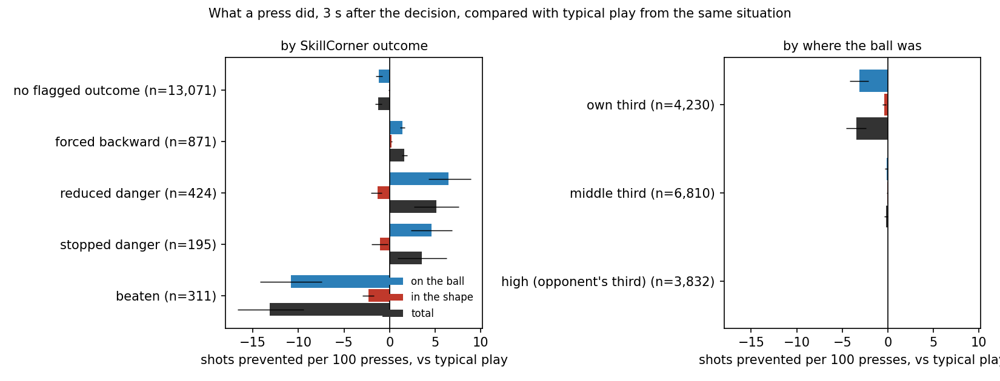
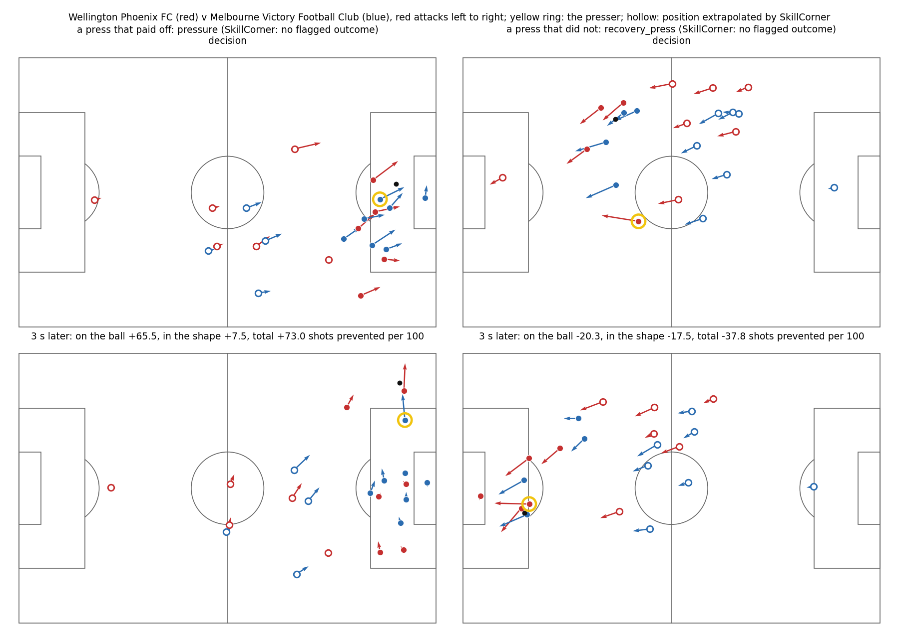

# What did the press do?

Every on-ball engagement SkillCorner records during an opponent possession (a defender pressing the ball carrier) is measured 3 s after the decision to press, against what typically happens from the same situation. Unit: the two-part model's chance of a shot in the next 5 s, with a won ball or a ball out of play counting as no danger and a shot as certain danger (`dsv/counterfactual.py`, `scripts/12_pressing.py`).

- **On the ball**: how much less dangerous the ball's position is than is typical from that situation, scored with a typical defense around it. Forcing the carrier back, winning the ball or kicking it out show up here.
- **In the shape**: how much better the defense covers the danger at that moment than a typical defense would with the ball where it now is, relative to what is typical after such situations. Space opened behind a press shows up here.
- **Total**: the two together; positive means the attack ended up less likely to shoot than is typical.

"Typical" comes from all moments in the other 19 matches, pressed or not, with the same ball situation, cover, time in possession, defenders goal-side and phase of play. Units: shots prevented per 100 presses. The decision point is 1 s before SkillCorner's engagement starts (the presser is then a median 9 m from the ball). Intervals: 95% match bootstrap.

**14,872 presses.** Mean on the ball -0.94, in the shape -0.14, total -1.07 per 100; 75% left the attack worse off than typical; 17% ended with the ball won or out of play within 3 s, 3.2% with a shot.

## Against SkillCorner's outcome flags

SkillCorner flags the outcome of each engagement from its own tracking rules, independently of this model.

| SkillCorner outcome | presses | on the ball | in the shape | total | attack worse off than typical | ball won or out by 3 s |
|---|---|---|---|---|---|---|
| beaten | 311 | -10.79 [-14.23, -7.41] | -2.35 [-2.98, -1.72] | -13.14 [-16.70, -9.40] | 30% | 10% |
| stopped danger | 195 | +4.62 [+2.36, +6.84] | -1.07 [-1.97, -0.20] | +3.55 [+0.87, +6.27] | 57% | 36% |
| reduced danger | 424 | +6.47 [+4.30, +8.91] | -1.34 [-2.02, -0.84] | +5.13 [+2.64, +7.57] | 63% | 28% |
| forced backward | 871 | +1.41 [+1.14, +1.68] | +0.22 [+0.18, +0.27] | +1.63 [+1.36, +1.91] | 93% | 0% |
| no flagged outcome | 13,071 | -1.18 [-1.55, -0.81] | -0.05 [-0.12, +0.01] | -1.24 [-1.60, -0.87] | 75% | 17% |

## By type and by zone

| SkillCorner subtype | presses | on the ball | in the shape | total | attack worse off than typical | ball won or out by 3 s |
|---|---|---|---|---|---|---|
| counter_press | 1,369 | +0.15 [-0.05, +0.35] | +0.00 [-0.10, +0.10] | +0.15 [-0.09, +0.40] | 86% | 7% |
| other | 2,063 | -2.79 [-3.78, -1.89] | -0.33 [-0.49, -0.16] | -3.12 [-4.22, -2.11] | 65% | 20% |
| pressing | 3,647 | +0.30 [+0.26, +0.35] | +0.05 [+0.03, +0.07] | +0.36 [+0.29, +0.41] | 91% | 11% |
| pressure | 4,059 | -0.12 [-0.64, +0.43] | +0.02 [-0.12, +0.12] | -0.10 [-0.63, +0.44] | 77% | 20% |
| recovery_press | 3,734 | -2.42 [-3.00, -1.79] | -0.43 [-0.58, -0.28] | -2.85 [-3.48, -2.14] | 59% | 20% |

| ball at the decision | presses | on the ball | in the shape | total | attack worse off than typical | ball won or out by 3 s |
|---|---|---|---|---|---|---|
| high (opponent's third) | 3,832 | +0.01 [+0.00, +0.02] | +0.01 [+0.00, +0.01] | +0.02 [+0.01, +0.03] | 89% | 20% |
| middle third | 6,810 | -0.14 [-0.30, +0.01] | -0.07 [-0.16, +0.01] | -0.21 [-0.42, +0.00] | 74% | 15% |
| own third | 4,230 | -3.09 [-4.17, -2.10] | -0.37 [-0.59, -0.18] | -3.46 [-4.59, -2.40] | 63% | 17% |

The own third dominates: a press there is a last line of defense, and its outcomes swing between a cleared ball and a shot. Far from goal the immediate danger is small either way; the main point of a high press, winning the ball for your own attack, is not counted by a measure of danger conceded.

## By team

| pressing team | matches | presses | on the ball | in the shape | total | total vs same type and zone |
|---|---|---|---|---|---|---|
| Newcastle United Jets FC | 1 | 441 | +1.45 | -0.38 | +1.06 | +2.21 |
| Melbourne City FC | 3 | 943 | +0.10 [-0.28, +0.48] | +0.13 [+0.11, +0.15] | +0.24 [-0.14, +0.64] | +0.84 |
| Perth Glory Football Club | 2 | 848 | +0.25 | -0.03 | +0.22 | +1.53 |
| Macarthur FC | 2 | 775 | -0.24 | -0.31 | -0.55 | +0.41 |
| Adelaide United Football Club | 3 | 1,177 | -0.31 [-0.98, +0.11] | -0.53 [-0.94, -0.20] | -0.84 [-1.91, -0.08] | +0.51 |
| Melbourne Victory Football Club | 4 | 1,223 | -0.89 [-2.62, +0.77] | -0.22 [-0.47, +0.05] | -1.10 [-3.00, +0.84] | +0.03 |
| Central Coast Mariners Football Club | 4 | 1,539 | -1.16 [-2.29, -0.08] | -0.04 [-0.27, +0.13] | -1.20 [-2.31, -0.05] | -0.08 |
| Auckland FC | 7 | 2,566 | -1.34 [-2.06, -0.76] | +0.03 [-0.08, +0.13] | -1.30 [-2.05, -0.80] | -0.38 |
| Sydney Football Club | 2 | 756 | -1.23 | -0.09 | -1.33 | -0.35 |
| Western Sydney Wanderers FC | 2 | 705 | -1.12 | -0.24 | -1.36 | -0.26 |
| Brisbane Roar FC | 3 | 1,064 | -1.37 [-1.92, -0.70] | -0.11 [-0.14, -0.04] | -1.49 [-2.07, -0.84] | -0.39 |
| Western United | 4 | 1,665 | -1.49 [-1.93, -0.88] | -0.18 [-0.41, +0.01] | -1.67 [-1.93, -1.33] | -0.70 |
| Wellington Phoenix FC | 3 | 1,170 | -2.05 [-3.06, -0.45] | -0.16 [-0.24, -0.07] | -2.21 [-3.30, -0.59] | -0.76 |

Intervals only for teams in at least 3 of the 20 matches.

## Players: role, not yet individual skill

Raw values mostly sort players by where they press: per position group (all presses),

| position | presses | share in own third | total | vs same type and zone |
|---|---|---|---|---|
| Central Defender | 1,229 | 48% | -9.47 | -7.39 |
| Midfield | 4,971 | 31% | -1.13 | +0.03 |
| Other | 402 | 25% | -0.92 | +0.05 |
| Full Back | 2,204 | 38% | -0.91 | +0.51 |
| Wide Attacker | 2,914 | 26% | +0.59 | +1.56 |
| Center Forward | 3,152 | 13% | +0.61 | +1.02 |

Central defenders stand out even against presses of the same type in the same zone. When they engage they are usually the last defender, so a lost duel is a chance at goal; comparing with typical play from the same ball situation does not see that role.

So players are compared on each press **against presses of the same SkillCorner type in the same zone** ("relative"). Players with at least 30 presses (164); 95% bootstrap intervals over their presses. **Is it a stable trait?** Splitting each player's presses into alternate halves, the correlation of the two halves' means across players is 0.49 for the relative value (Spearman-Brown reliability of a player's full mean 0.66); 0.10 (0.18) after also removing position-group means. For the raw total it is 0.55, much of it position.

**Within a position group the two halves barely agree**, so with 20 matches a player's pressing value cannot yet be told apart from noise once their role is accounted for. The table is shown for transparency, not as a ranking; a season of data per player would be needed.

| player | team | position | presses | in own third | relative [95%] | total | on the ball | in the shape |
|---|---|---|---|---|---|---|---|---|
| Dean Bosnjak | Macarthur FC | Wide Attacker | 40 | 42% | +5.89 [+3.36, +8.73] | +4.29 | +4.10 | +0.19 |
| Fabian Talladira | Adelaide United Football Club | Full Back | 38 | 63% | +5.60 [+2.25, +9.16] | +2.79 | +3.79 | -1.00 |
| Callum Timmins | Newcastle United Jets FC | Midfield | 41 | 44% | +5.05 [-0.73, +10.91] | +3.64 | +3.82 | -0.18 |
| Dylan Pierias | Adelaide United Football Club | Full Back | 60 | 53% | +4.75 [+0.76, +9.27] | +2.65 | +3.51 | -0.86 |
| Joel  Anasmo | Perth Glory Football Club | Wide Attacker | 32 | 53% | +4.32 [+2.23, +6.46] | +2.64 | +1.89 | +0.75 |
| Harry Van Der Saag | Brisbane Roar FC | Full Back | 38 | 45% | +4.10 [+0.82, +8.85] | +2.37 | +1.97 | +0.40 |
| Sam Sutton | Wellington Phoenix FC | Full Back | 73 | 37% | +4.00 [+0.35, +7.29] | +2.61 | +2.62 | -0.01 |
| Eli Adams | Newcastle United Jets FC | Wide Attacker | 63 | 37% | +3.93 [+1.77, +6.32] | +2.98 | +3.25 | -0.27 |
| Daniel Hall | Auckland FC | Central Defender | 60 | 37% | -8.07 [-14.62, -2.30] | -9.88 | -8.84 | -1.04 |
| Isaac Hughes | Wellington Phoenix FC | Central Defender | 44 | 59% | -10.02 [-18.88, -1.27] | -12.26 | -13.04 | +0.79 |
| Brendan Hamill | Melbourne Victory Football Club | Central Defender | 30 | 47% | -10.16 [-18.26, -2.59] | -12.69 | -10.42 | -2.27 |
| Panagiotis Kikianis | Adelaide United Football Club | Central Defender | 51 | 53% | -11.58 [-20.02, -3.92] | -14.23 | -12.04 | -2.19 |
| Dylan Leonard | Western United | Central Defender | 71 | 48% | -12.43 [-19.85, -5.77] | -14.73 | -14.06 | -0.67 |
| Nando Pijnaker | Auckland FC | Central Defender | 54 | 44% | -12.68 [-19.86, -6.34] | -14.61 | -14.40 | -0.20 |
| Scott Wootton | Wellington Phoenix FC | Central Defender | 47 | 74% | -15.18 [-25.56, -5.48] | -18.26 | -16.25 | -2.01 |
| James Donachie | Western United | Central Defender | 34 | 38% | -15.68 [-26.44, -5.65] | -17.79 | -16.56 | -1.23 |

## Two presses

## Why not "what if they had held their position?"

The brief's first design moved only the presser: same moment, presser carried back into the shape (their position at the decision, moved along with their teammates), everyone else and the ball where they really were. Over 11,947 presses still live 3 s later, that comparison says pressing gave better cover than holding 59% of the time (mean -0.09 shots per 100 against pressing; holding from 2 s before instead: -0.10, correlation 0.96; dropping toward goal instead: +0.05). The reason is built in: the teammates who shifted to cover for the presser stay where they are, so a presser who "holds" only duplicates their cover and nobody is near the ball. A fair counterfactual would have to move the whole defense, which needs a model of how teams reorganize. Measuring against typical play from the same situation sidesteps that, at the price below.

## Limits

- The grade compares what happened with what is typical, so a single press's value includes the luck of how it went; averages over many presses (player, team, zone) are the measurement, single presses are illustrations.
- Defenders choose when to press, so "typical play from the same situation" is not a randomized comparison; the situation features (ball, cover, time, defenders goal-side, phase) remove only what they describe.
- SkillCorner's engagements include light pressure as well as full presses ("no flagged outcome" is most of them).
